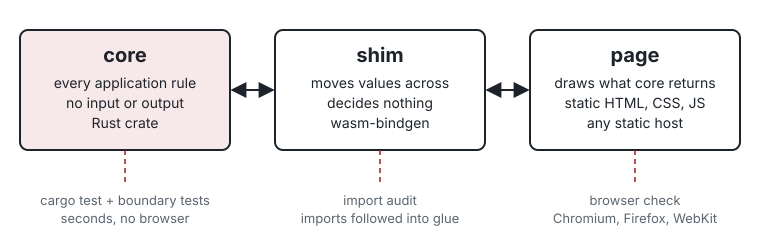

# Builder

Builder is a setting for making small browser tools and games with a coding agent. Every rule of the tool lives in a Rust library that cannot reach the browser, the clock, the network or the disk. A thin WebAssembly shim moves values between that library and the page, and it makes no decisions. A static page draws what the library returns. Tests read the repository's own source and fail when a rule leaks out of the library, when the shim starts deciding, or when the page starts computing.

The setting was published on 7 October 2026. In the six days after, its author built thirteen projects from it, and Peter (ptonkle), working on his own from the public repository, built two more: Mandible, an ant strategy game, and Ape Race, a vine-swinging racer. Peter now co-designs Builder, and several of the template's conventions come from his games. Most of the thirteen began as a plain-prose description from a friend of the author who does not write code; the author rewrote each description as a Builder brief and started the build.

| Project | Kind | Core tests | First to last commit |
| --- | --- | --- | --- |
| Iron Vector | 3D mech game | 209 | 8–9 Oct |
| Food Truck Circus | 3D trampoline game | 111 | 9–10 Oct |
| Long Time Comin' | 3D bullet-hell roguelike | 242 | 10–12 Oct |
| Pursuer | 3D driving game with a destructible city | 112 | 10–11 Oct |
| Graftwood | 3D auto-battler | 107 | 10–11 Oct |
| Ribbit King | 3D frog golf | 91 | 10–11 Oct |
| Lowballer | 2D marketplace game | 41 | 10 Oct |
| Raiders of the Lost Mart | 4-player co-op shooter, rollback netcode | 110 | 11–12 Oct |
| Gatecrasher | 3D stealth game | 108 | 12 Oct |
| Status Trends | CSV dashboard (a tool) | 92 | 12 Oct |
| Level Twenty | 3v3 auto-battler | 107 | 12–13 Oct |
| Packet Alley | TCP/IP teaching game | 24 | 12–13 Oct |
| Surf's Up | 8-player movement game | 55 | 13 Oct |

Core tests are `#[test]` functions under `crates/`, counted from each repository's source on 13 October 2026, including the boundary tests every project inherits. Peter's sources are not public, so his games are not in the table.



## Start from a description

You do not need to write code to use Builder.

```bash
git clone https://github.com/sgilson7/builder-setting.git
cd builder-setting
claude          # or another coding agent that reads CLAUDE.md or AGENTS.md
```

Then describe the tool in your own words: what it is for, who uses it, what a good result looks like, and what from your own field it has to get right. If you want it published, name the repository and say the agent may publish. The agent does the step the author did by hand for the projects above: it copies the template into a new directory, writes the brief from your words, starts a design journal beside the project and reads Builder and your description back to you there, builds the tool with its tests, and publishes it if you allowed that. Later changes are more plain prose ("the hint should name the element, not the side"). [`prompts/start-from-description.md`](prompts/start-from-description.md) is the procedure the agent follows. The project is a new folder next to the clone; start later sessions inside it, so the agent reads the project's own rules from the beginning.

What you still own: the content and whether it is right in your field, whether the tool does what you meant, and the decision to make it public. Use the tool on one case you have worked out by hand before you share it.

## Start from the template

```bash
git clone https://github.com/sgilson7/builder-setting.git
cp -R builder-setting/template my-tool
cd my-tool && git init
./scripts/setup.sh     # once: Playwright and three browser engines
./scripts/check.sh     # the blank template passes before you change anything
```

Write `BRIEF.md`, then point your coding agent at the directory. It reads `CLAUDE.md` or `AGENTS.md` first, and those send it to `BRIEF.md`, `BUILDER-SPEC.md` and `GLOSSARY.md`.

You need Rust (the template pins its toolchain in `rust-toolchain.toml`, with the `wasm32-unknown-unknown` target), `wasm-bindgen-cli` 0.2.127 and Python 3. The art pipeline also needs `pdflatex` and Poppler's `pdftocairo`; the everyday check does not.

```bash
cargo install wasm-bindgen-cli --version 0.2.127 --locked
```

## The problem Builder addresses

A coding agent writes code faster than a person can read it. A finished game from one of these sessions runs to thousands of lines across Rust, JavaScript, shaders and data. The person who asked for it needs a way to trust that the code does what the brief said without reading all of it, and a person who does not write code cannot read it at all.

Builder decides in advance where each kind of code may live, and checks that decision with tests the agent runs on every change. The person reads the brief, the plan, the notebook and the tool itself. The tests read the rest.

## One rulebook, tested without a browser

The core crate holds every rule and state transition: scoring, physics, turn order, what a button is allowed to do, what an error says. It performs no input or output, so `cargo test` reaches every rule in a few seconds without starting a browser.

That speed changes how the agent works. An agent finds most of its own mistakes by running something and reading the failure. A failing Rust assertion names the function, the input and the expected value. A failing browser test names a selector and a timeout, and the agent then has to guess which of several layers went wrong. When the rule lives in the core, the agent can rerun the whole suite after every edit, and it does.

The core is deterministic by default. Floats, hash maps, clocks and randomness are banned from its source; randomness comes in as a seed and time as a tick count. The same inputs give the same outputs on every machine. The games rely on this for more than stable tests: replays and ghosts store a start state and inputs, lockstep and rollback multiplayer need every peer to compute the same state, and 3D physics runs in fixed-point arithmetic (Q16.16), so a collision resolves the same way in Chrome on one laptop and Safari on another.

An error carries the message the page will show, so the wording of a rule's failure sits beside the rule and a test can pin both. Settings, screens and flags enter the core through one function, `act(name, value)`, with dotted names such as `screen.show`. The core's dispatch is one `match` the suite can test, and a new option needs no new shim function.

## The shim decides nothing

The shim is the `wasm-bindgen` crate that exposes the core to JavaScript. Each exported function converts its arguments, makes one call into the core, and converts the result back. A boundary test fails if `if`, `else`, `match`, `for`, `while`, `loop` or the `?` operator appears in its source.

The rule comes from a failure. One of the seven tools that preceded Builder grew a shim of several thousand lines, and during play a barrel showed one price and sold at another, because the shim performed its own lookup. The shim is the nearest place to the page, so an agent under pressure to make a feature work tends to put the fix there. The test removes that option, and the fix goes into the core where the suite can see it.

## The page draws

The page is HTML, CSS and JavaScript with no framework, bundler or package manager. It loads the module, fetches its text from `data/`, passes values to the shim and draws what comes back.

Page JavaScript may not hold a numeric literal other than 0 and 1, may not call `Math`, `parseInt`, `Number` or `toFixed`, may not navigate away on its own, and may not behave differently under automation. A number in the page is usually a copy of a rule. Agents copy logic into the interface to make a display come out right, and then the two copies drift apart.

The template meets that rule the way Peter's games do. The core returns a view model, `ui`, naming the screen and its panels and actions, and the page builds the DOM from it without knowing what any panel means. For a canvas or WebGL page, the core returns a draw list of integers and the page replays it with op codes, colours, shapes and scales the core sent once ([`kits/canvas/`](kits/canvas/)). Sounds and icons can arrive from the core as bytes. A page built this way has no number to hold and no screen to know about, so the scan has little to catch. Shaders live in `data/shaders/`, hold no number other than 0 and 1, and take the values a rule depends on as uniforms from the core.

## Words: a glossary and a tone file

Every reader-visible string lives in `data/`. `GLOSSARY.md` defines every term the tool uses in one or two plain sentences: each unit, resource, mode, score and status. It is the source of truth for what a word means, and strings, tests, the plan and the README use each term in its sense. Each entry may carry a `Not:` line of words that must never be used for it, and a number a rule decides is written as a `{placeholder}` the core fills, so the glossary cannot disagree with the rules. The page shows a definition when a reader hovers the term.

The glossary comes from Peter's Mandible, where hovering any term shows its definition. The `Not:` line comes from Slushline, whose copy test caught the agent's own settings strings using "nozzle" and "tap" for a spout.

`TONE.md` holds the rules every string follows and a list of stock phrases a test rejects. The core parses the glossary, and `crates/core/tests/copy.rs` fails when a string uses a ruled-out word, when a definition types a rule's number, or when a string, definition or README line uses a listed phrase.

## Tests as constraints on the model

The instruction files (`CLAUDE.md`, `AGENTS.md`) tell the agent where code belongs. Instructions alone do not hold over a long session. A model's attention to an instruction weakens as the context fills, a context summary can drop it, and under pressure to finish a model can reason its way to an exception. A failing test does not weaken. The only way past it is to edit the test, and that edit is visible in the diff and forbidden by the instruction files.

Builder pairs each architectural instruction with a test. The instruction says why the rule exists; the test makes it hold. The boundary tests in `crates/core/tests/boundary.rs` check that:

- the core's source names no input or output API and no float, hash map, clock or random source;
- the core depends only on crates in an allowlist;
- the shim contains no branch, loop or `?`;
- page JavaScript, at any depth under `web/`, contains no arithmetic, number parsing, network API, code from strings, navigation or automation check;
- shaders hold no tuning numbers;
- no file under `web/` names another origin;
- every HTML page carries a Content-Security-Policy.

Beside them, `copy.rs` checks the words, `no_storage.rs` checks that the page keeps nothing between visits unless the brief allows it, and `scripts/check-style-leak.py` keeps the default style pack inside `template/styles/`.

These tests read source text, not meaning. A rule hidden in the page as a string comparison or a lookup table can pass them. They set a floor, and the person's reading of the plan and their use of the tool cover what the scans cannot see.

When a requirement seems to block necessary work, the agent stops and writes a row in `SECOND-ORDER.md` naming the requirement, what the feature needs and the options it can see. The moment where an agent would otherwise loosen a rule quietly becomes a decision the person makes.

## A check is trusted after it has been seen to fail

`scripts/prove-checks.sh` copies the minimal example, plants one defect at a time, and requires the check meant to catch it to fail with a message that names the defect. It plants 38, among them a float, a `println!` and a hash map in the core, a branch in the shim, a copy of a rule in a nested page file, a tuning number in a shader, a page that navigates or checks for automation, browser storage, a word the glossary rules out, a stock phrase, a vendored file that does not match its checksum, an empty list of breaks, and a default-style colour in the template's CSS. A run with nothing planted fails too.

Writing that script found a gap. With the CSP in place, the browser blocks a forbidden fetch before it becomes a request, so a check that listened only for requests saw nothing. The browser check now records CSP violations as their own failure.

Inside a project, `scripts/break_tests.py` does the same for behaviour: each row of `tests/breaks.json` breaks one rule, runs its test, requires a failure and restores the file. It fails when a break's text has moved (the break has rotted) and when the list is empty. Long Time Comin' ran 132 such breaks and found tests that passed while broken "because a second line kept the behaviour". Mutation testing (`scripts/mutants.sh`) makes small changes across the core; its share caught measures how much current behaviour the tests pin down, and it is not a bug rate.

## Why Rust and WebAssembly

- **The compiler is the first check.** Types, exhaustive `match` and the borrow checker reject a class of mistakes before any test runs, and the compiler's messages say what to change. Agents appear to iterate well against these messages, though Builder has not measured that against another language.
- **The tested code is the shipped code.** The core compiles natively for `cargo test` and to WebAssembly for the page. There is no second implementation of the rules for the browser.
- **The module's imports are an inventory.** A WebAssembly module reaches the page only through what it imports. `scripts/wasm_imports.py` lists the imports, follows each into the generated glue, and fails if one names a network API.
- **Speed.** The 3D games run physics, collision and camera maths in the core at 60 ticks a second.
- **Fewer moving parts.** There is no npm, bundler or framework on the page side, the core's dependencies are on an allowlist, and the toolchain is pinned. An agent has less to install, upgrade or break.

## Why a static page

The finished tool is a folder of static files. It deploys to GitHub Pages and runs with nothing behind it. A person's data stays in their browser tab, which matters for the teaching tools the setting was first built for: a teacher can open a gradebook export and nothing is uploaded.

The default build makes no request to another origin while it loads and idles. The CSP enforces that in the browser, and `tests/browser/check.py` watches every request, WebSocket, popup and worker in Chromium, Firefox and WebKit, with a phone profile on request. After the person publishes, the same check runs against the live address. The build stamps a content hash on every internal URL, because GitHub Pages caches files for ten minutes and a returning reader would otherwise keep the old module.

Online play is the main departure, and Builder handles it as a declared one. A project that wants it says so in its brief, vendors the networking library with a SHA-256 checksum, lists each relay by address in one config file that a test matches against the CSP, and loads the transport only when a player hosts or joins, so the load-and-idle path stays clean. [`kits/online/`](kits/online/) holds the pattern, from Peter's transport design and four of the author's online games.

## The procedure

| Stage | Who | File |
| --- | --- | --- |
| 0 Opening entry | agent, then person | the design journal |
| 1 Brief | person, or the agent from the person's description | `BRIEF.md`, `GLOSSARY.md` |
| 2 Plan | agent | `PLAN.md` |
| 3 Read the plan | person, unless approved in advance | `PLAN.md` |
| 4 Measure | agent | `MEASUREMENTS.md` |
| 5 Build with tests | agent | code, tests, `tests/breaks.json` |
| 6 Second-order notebook | agent | `SECOND-ORDER.md` |
| 7 Use and triage | person | `TRIAGE.md`, numbered rows in the person's words |
| 8 Publish and check | person, or the agent if the brief grants it | `scripts/publish.sh`, then the browser check against the live address |
| 9 Handoff | agent | `HANDOFF.md` |

The person describes the tool, uses it and decides whether it is published. The agent writes everything in between and records its assumptions and divergences in `SECOND-ORDER.md` as it works, which is how the person sees what the agent decided alone ([why](docs/procedure.md#the-second-order-notebook)). Each later request becomes a numbered `TRIAGE.md` row, and the commit that answers it cites the number. [`docs/procedure.md`](docs/procedure.md) describes each stage.

## The design journal

Every project keeps a design journal unless its brief says `none`: an HTML page of dated entries beside the project, never pushed, where the person reads the build and answers by number. It opens, before the plan, with the agent reading Builder and the brief back to the person as numbered rules, each with what holds it, plus the question prefix, the stop points and its questions. The person corrects that reading before anything is built on it, and the answers move the lasting rules into `CLAUDE.md` and tests. After that, each decision put to the person (with the default the agent builds on), each visible change (with pictures of the running build), each divergence from the plan and each deploy gets an entry that cites the notebook and triage rows it reports. `scripts/journal_check.py` checks the journal's form and its links to those rows. The form comes from Peter's Ape Race and the games built after it; [`docs/journal.md`](docs/journal.md) describes it.

## What a pass does not show

A pass describes what happened on the paths the checks drove. A feature the browser interactions never start is a feature the check never saw. The boundary scans read text. The core suite shows that the rules hold on the cases the tests state, and whether those are the intended cases is the brief's question and the person's. The checks narrow what a person has to read; they do not replace the reading, and for a person outside software, using the tool on a case they have worked out by hand is the reading.

## Art

When a tool needs 2D art, `template/tools/art/` writes it as TikZ and renders it to PNG; nothing in the pipeline holds a colour of its own. A brief may name a style or supply a style pack. When it names none, the pipeline uses the default pack in `template/styles/default/`. That pack is a fallback and stays where it is: a check fails if its colours or its name appear anywhere else in Builder. [`docs/art.md`](docs/art.md) describes both.

## Kits

Optional parts a project copies on purpose, each stating which reference default it changes: [`kits/online/`](kits/online/) (peer-to-peer play), [`kits/canvas/`](kits/canvas/) (a draw-list renderer and screenshots the game takes of itself), [`kits/realtime/`](kits/realtime/) (pointer lock, input between ticks, probes, frame rate), [`kits/mobile/`](kits/mobile/) and [`kits/privacy/`](kits/privacy/). See [`kits/README.md`](kits/README.md).

## The contract and the check

The full contract is [`BUILDER-SPEC.md`](BUILDER-SPEC.md). It separates **Builder requirements** (R1–R9), which define Builder, from **reference defaults** (D1–D18), which this repository chose so that a copy works at once, and from **project decisions**, which stay with the person. A project that changes a default records the change in the spec's table.

```bash
./scripts/check.sh
```

In a project, that runs format and lint, the core, boundary, copy and storage tests, the release build with cache-busting and checksum verification, the WebAssembly import audit, the art pipeline's checks, the notebook and journal checks, and the browser check. In this repository it also checks that the template and example agree, that links resolve, that the style pack stays put, that every break in the template and example is caught, and that every planted defect is caught. [`docs/checks.md`](docs/checks.md) says what each establishes and what still needs a person.

## Examples and prompts

- [`examples/minimal/`](examples/minimal/) is a bounded counter: one rule in the core, its tests, a glossary, the shim, a page, a browser interaction and the full check.
- [`prompts/`](prompts/) holds the prompts for starting from a description or a brief, reviewing a plan and auditing the boundary, and a template for writing a prompt set.
- [`prompts/sets/C-feedback-drafts.md`](prompts/sets/C-feedback-drafts.md) is a prompt set from a teacher's request; a fresh agent session built [Feedback Drafts](https://github.com/sgilson7/feedback-drafts) from it.

## Documentation

[Architecture](docs/architecture.md) · [Procedure](docs/procedure.md) · [Design journal](docs/journal.md) · [Checks](docs/checks.md) · [Glossary and tone](docs/glossary.md) · [Art](docs/art.md) · [Online play](docs/online.md) · [Adoption](docs/adoption.md) · [Mapping to the paper](docs/paper-mapping.md) · [Releases](docs/release.md)

## Credits

Builder is designed by Sam Gilson with Peter (ptonkle), who tested it by building from a clean copy and contributed the view model, the one-door action function, the draw-list renderer, the glossary, the online transport's design and the design journal from his games.

## Citation

Cite the version you used. [`CITATION.cff`](CITATION.cff) and [`CITATION.bib`](CITATION.bib) describe this repository. A paper describing Builder is under review, and its reference will be added here when it can be cited.

## License

MIT. See [`LICENSE`](LICENSE).
